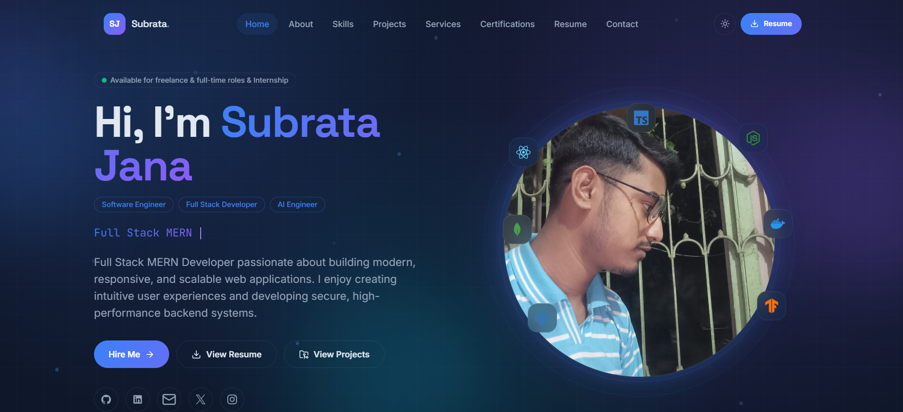
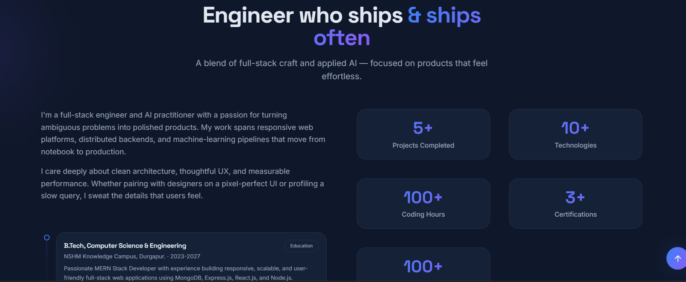
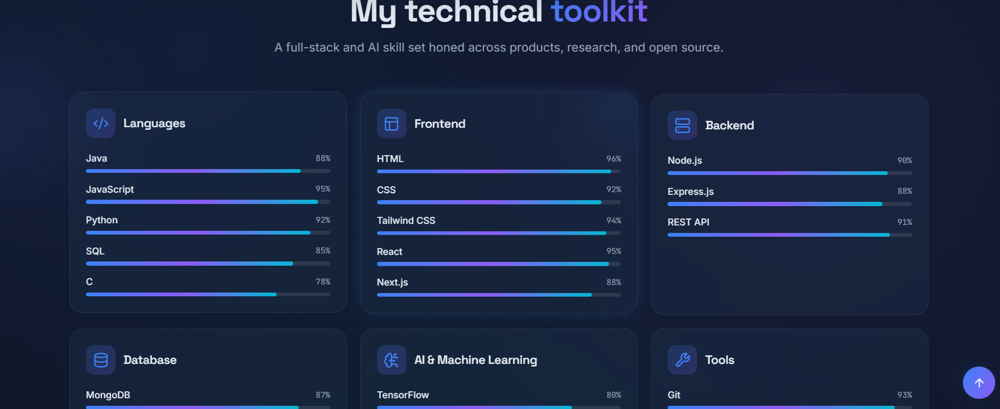
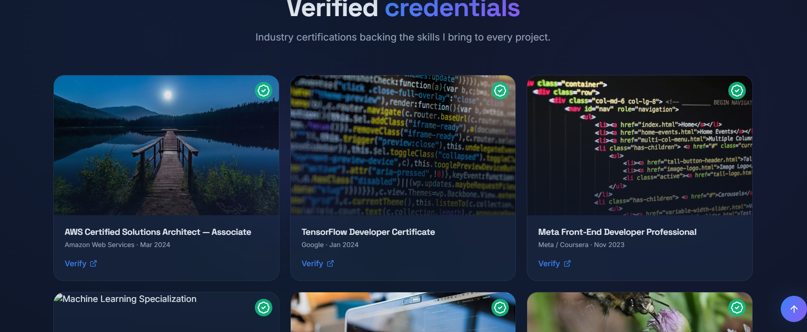
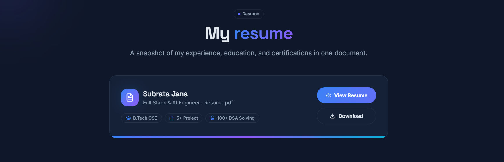
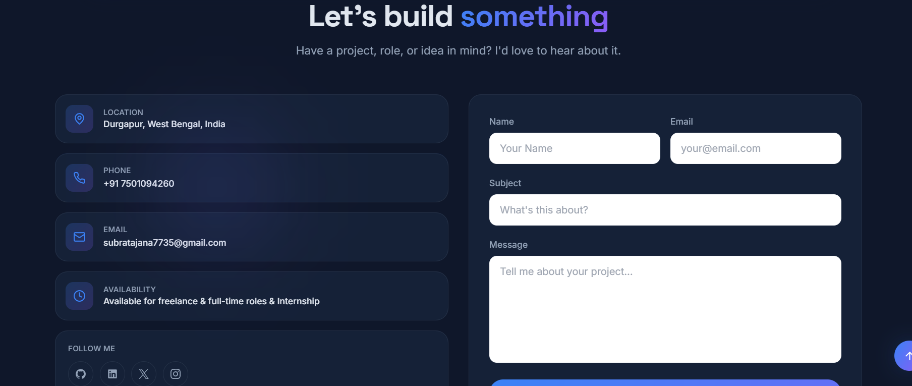

# Live here 
https://subratadev.netlify.app/
# My Portfolio


A modern Full Stack Developer Portfolio built with React, Vite, Tailwind CSS and Framer Motion.

## Features

- Responsive Design
- Dark Mode
- Animated UI
- Contact Form
- Project Showcase
- Skills Section

## Tech Stack

- React
- Vite
- Tailwind CSS
- Framer Motion
- EmailJS

## Installation

```bash
git clone https://github.com/yourusername/portfolio.git
cd portfolio
npm install
npm run dev
```

<h2>Project Screenshots</h2>

<p align="center">
  
  
</p>

<p align="center">
  
  
</p>

<p align="center">
  
  
</p>

<p align="center">
  
</p>

